# ci-pinpoint

**Point at the exact lines that broke a CI build, explain why, and prove it.** Every line
it cites is checked against the log, and your coding agent gets a 2,000-token brief instead
of a 200,000-token log.

[](https://github.com/xeeshan16/ci-pinpoint/actions/workflows/ci.yml)


> Status: **day 5 of 7**. Works end to end on real logs, measured on a public labelled
> dataset ([results](#evaluation)), with secrets redacted and log text treated as untrusted
> input ([how](#untrusted-logs-secrets-and-prompt-injection)). Use it from the command line,
> from a coding agent over [MCP](#from-a-coding-agent-mcp), or as a
> [GitHub Action](#in-github-actions); GitHub Actions and GitLab runs both work. Tracing,
> cost accounting and a Docker image come next (see [docs/PLAN.md](docs/PLAN.md)).

## What it does

A real failed job from this author's own CI: 4,621 lines, 19 failing tests, and the one
line that matters is a `Caused by` buried under Spring stack traces. Nothing near the end
of the log says what went wrong.

```console
$ ci-pinpoint explain https://github.com/xeeshan16/kafka-llm-enricher/actions/runs/40196005593 --no-llm --budget 600
✖ build, static analysis, tests, coverage
  https://github.com/xeeshan16/kafka-llm-enricher/actions/runs/40196005593/job/121176855639
  failed step: Compile (Error Prone), unit and integration tests (Testcontainers), coverage

  excerpt: 589 of ~161,427 tokens (99.6% smaller), 4 block(s)

  L2077   	... 36 more
  L2078   Caused by: java.lang.IllegalArgumentException: unknown PII type 'pan,iban,email,phone'; use pan, iban, email or phone
  L2079   	at io.github.xeeshan16.enricher.privacy.PiiDetectors.named(PiiDetectors.java:70)
  [... 2 more blocks of failing-test assertions ...]
  L4495   [INFO] BUILD FAILURE
      …
  L4500   [ERROR] Failed to execute goal org.apache.maven.plugins:maven-surefire-plugin:3.5.4:test (default-test) on project enricher-spring-boot-starter: There
```

(Real output, abridged in the middle; the run is public. `--no-llm` shows the selection
stage alone, no model involved.)

Without `--no-llm`, a model (local Ollama by default) reads only that excerpt and returns a
diagnosis in a fixed schema: category, summary, root cause, cited lines and a suggested fix.
Citations that don't match the log are dropped before you see them.

<!-- sample-output:start -->
Real model output (Ollama, `qwen2.5:3b` on a CPU-only GitHub runner, 2,000-token budget),
recorded in [real-model run 42667018690](https://github.com/xeeshan16/ci-pinpoint/actions/runs/42667018690)
on a smoke test that failed without printing a single error word:

```text
### ✖ docker image, compose demo smoke test

**The job failed with exit code 1 due to missing configuration.**

`compile` · confidence 1.00 · `ollama/qwen2.5:3b`

**Root cause.** The job encountered an issue with missing configuration for the
'gen_ai_request_model' and 'gen_ai_token_type' metrics. This is indicated by the log entry
'MISSING              gen_ai_request_model' and 'MISSING              gen_ai_token_type'.
The missing configuration prevents the application from starting correctly.

**Evidence** (each line checked against the log):

- `L1757` `MISSING              gen_ai_request_model`
- `L1758` `MISSING              gen_ai_token_type`

**Suggested fix.** Ensure that the 'gen_ai_request_model' and 'gen_ai_token_type' are
properly configured in the application's configuration files.

_Excerpt: 961 of ~63,069 tokens (98.5% smaller), 3 block(s)._
```

The cited lines are right; the category (`compile`) and the last sentence of the root cause
are not: the metrics were missing from the export, the app had started. The day 4 taxonomy
did not fix categories for a 3B model, so agent-facing output labels the category a hint.
On all six labelled logs in that run, a 3B local model produced a verified
diagnosis for 5 and cited the labelled root-cause line in 4 (details in
[docs/PROGRESS.md](docs/PROGRESS.md)). These are six logs, not an evaluation.
<!-- sample-output:end -->

## Quick start (5 minutes)

```bash
# 1. Install (not on PyPI yet; pipx works too)
uv tool install git+https://github.com/xeeshan16/ci-pinpoint

# 2. A local model (or set OPENAI_API_KEY / ANTHROPIC_API_KEY / the Azure variables instead)
ollama pull qwen2.5:3b

# 3. Explain a failed GitHub Actions run. Downloading logs needs a token,
#    even for public repositories.
export GITHUB_TOKEN=$(gh auth token)
ci-pinpoint explain https://github.com/<owner>/<repo>/actions/runs/<run_id>

# ...or any log file, gzip file, or stdin
ci-pinpoint explain build.log
kubectl logs job/integration-tests | ci-pinpoint explain -
```

Prefer a container? The image runs the same CLI (mount the directory with your logs):

```bash
docker build -t ci-pinpoint https://github.com/xeeshan16/ci-pinpoint.git
docker run --rm -e GITHUB_TOKEN -v "$PWD:/work" ci-pinpoint explain build.log
```

GitLab works the same way: `ci-pinpoint explain https://gitlab.com/<group>/<project>/-/jobs/<id>`
(or a `/-/pipelines/<id>` URL for all its failed jobs), with `GITLAB_TOKEN` set: gitlab.com
answers 401 for job logs without one, even on public projects.

Running `explain` again on the same log with the same settings is answered from the local
cache, with no model call. Useful flags: `--format markdown|json` (Markdown for PR comments and job summaries, JSON for
agents and scripts), `--no-llm` (just the selected lines), `--budget 4000` (excerpt size in
tokens), `--rerank` (one extra model call to re-rank candidate blocks), `--no-redact`,
`--show-excerpt`, `-v`.

Exit codes: `0` diagnosed with at least one verified citation (or `--no-llm`), `1` the model
could not produce a verified diagnosis (the selected lines are still printed), `2` bad input
or configuration.

### From a coding agent (MCP)

`ci-pinpoint mcp` is an MCP server over stdio with four tools: `diagnose_run` (the brief),
`get_excerpt` (the selected lines, no model), `search_log` and `get_log_lines` (to follow a
citation). The agent gets a few-KB brief instead of the raw log. In Claude Code:

```bash
claude mcp add ci-pinpoint --env GITHUB_TOKEN=$(gh auth token) \
  -- uvx --from git+https://github.com/xeeshan16/ci-pinpoint ci-pinpoint mcp
```

Then ask: *"CI failed on https://github.com/acme/app/actions/runs/123, find out why and fix
it."* What the agent gets back from `diagnose_run`, recorded with the official MCP Python SDK
client and Ollama `qwen2.5:3b` on a CPU-only runner (82.8 s;
[real-model run 43226199981](https://github.com/xeeshan16/ci-pinpoint/actions/runs/43226199981)):

```markdown
**The application failed to export all required metrics, causing the build to fail.**

`test` (category hint) · confidence 0.95 · `ollama/qwen2.5:3b`

**Root cause.** The application did not export the required metrics 'gen_ai_request_model'
and 'gen_ai_token_type', resulting in a missing value error. [...]

**Evidence** (each line checked against the log):

- `L1757` `MISSING              gen_ai_request_model`
- `L1758` `MISSING              gen_ai_token_type`

_Excerpt: 1,978 of ~63,069 tokens (96.9% smaller), 5 block(s)._
```

The cited lines are exactly the labelled ones; the category is not (this was a smoke test
of exported metrics), which is why agent-facing output calls it a hint. A follow-up
`get_log_lines` around L1757 returned in under 0.1 s from the in-memory cache. Ready-to-paste configs for Cursor and VS Code are in [examples/mcp](examples/mcp); the
tools, safety properties (redaction, untrusted-text labels, file roots, token scoping) and
protocol support are in [docs/mcp.md](docs/mcp.md).

### In GitHub Actions

Add a job that runs when another job fails. It writes the brief to the run's summary page,
adds an annotation per failed job, and exposes the brief as outputs:

```yaml
  explain:
    needs: [test]
    if: failure()
    runs-on: ubuntu-latest
    permissions:
      actions: read
    steps:
      - uses: xeeshan16/ci-pinpoint@main
        env:
          OPENAI_API_KEY: ${{ secrets.OPENAI_API_KEY }} # optional
```

Without a model configured it reports the selected log lines only (a hosted runner has no
local Ollama). Inputs: `source` (defaults to the current run), `provider`, `model`,
`base-url`, `budget`, `no-llm`, `annotate`, `github-token`. Outputs: `brief-json`,
`summary`, `diagnosed`. More in [examples/workflows](examples/workflows), including a
`workflow_run` variant for explaining another workflow's failures. Outputs contain model
text derived from the log: pass them to scripts through `env`, never inline with `${{ }}`.
The CLI has the same pieces for other CI systems: `--summary-file`, `--json-out` and
`--github-annotations`.

## Configuration

Flags override environment variables, which override `.ci-pinpoint.toml` in the working
directory (or the file named by `CI_PINPOINT_CONFIG`). See [.env.example](.env.example).

| Variable | Default | Meaning |
|---|---|---|
| `CI_PINPOINT_PROVIDER` | `auto` | `ollama`, `openai`, `anthropic`, `azure`, `openai-compatible`, `fake` (tests only) |
| `CI_PINPOINT_MODEL` | per provider | `qwen2.5:3b` (Ollama), `gpt-4.1-mini`, `claude-haiku-4-5`; Azure uses the deployment |
| `CI_PINPOINT_BASE_URL` | | any OpenAI-compatible server, e.g. vLLM `http://localhost:8000/v1` |
| `OLLAMA_HOST` | `http://localhost:11434` | Ollama server |
| `OPENAI_API_KEY`, `ANTHROPIC_API_KEY` | | hosted providers |
| `AZURE_OPENAI_ENDPOINT`, `AZURE_OPENAI_API_KEY`, `AZURE_OPENAI_DEPLOYMENT`, `AZURE_OPENAI_API_VERSION` | | Azure OpenAI |
| `GITHUB_TOKEN` / `GH_TOKEN` | | download Actions logs; `GITHUB_API_URL` for GitHub Enterprise |
| `GITLAB_TOKEN` | | download GitLab job logs (`read_api`); `CI_JOB_TOKEN` inside GitLab CI. Sent only to gitlab.com or the host in `GITLAB_API_URL` / `CI_API_V4_URL` / `CI_SERVER_HOST` / `GITLAB_HOST` |
| `CI_PINPOINT_MCP_ROOTS` | working directory | directories the MCP server may read log files from (`:`-separated) |
| `CI_PINPOINT_BUDGET_TOKENS` | `2000` | excerpt size sent to the model |
| `CI_PINPOINT_TIMEOUT_S`, `CI_PINPOINT_MAX_RETRIES` | `120`, `3` | per-call timeout, retries with backoff |
| `CI_PINPOINT_EMBEDDER`, `CI_PINPOINT_EMBED_MODEL` | `none` | block re-ranking: `ollama` (`nomic-embed-text`), `openai` (`text-embedding-3-small`), `openai-compatible` (+ `CI_PINPOINT_EMBED_BASE_URL`), `auto` |
| `CI_PINPOINT_RERANK` | `false` | re-rank candidate blocks with the chat model before selection (`--rerank`) |
| `CI_PINPOINT_REDACT` | `true` | redact secrets from the log before anything else (`--no-redact` turns it off) |
| `CI_PINPOINT_CONCURRENCY` | `4` | failed jobs of one run diagnosed at once (`--concurrency`); local models serialise |
| `CI_PINPOINT_CACHE_DIR` | `~/.cache/ci-pinpoint` | verified briefs and embeddings; `--no-cache` or `CI_PINPOINT_NO_CACHE=1` to bypass |
| `CI_PINPOINT_PRICE_IN`, `CI_PINPOINT_PRICE_OUT` | | USD per 1M input/output tokens, to price with your own contract (overrides the built-in table) |
| `CI_PINPOINT_OTEL` | `false` | emit OpenTelemetry traces and metrics (needs the `otel` extra; see [observability](docs/observability.md)) |
| `CI_PINPOINT_LOG_FORMAT` | text | `json` for structured logs on stderr |

With `auto`, the provider is picked from what is set: `ANTHROPIC_API_KEY`, then
`AZURE_OPENAI_ENDPOINT`, then `OPENAI_API_KEY`, then `CI_PINPOINT_BASE_URL`, then local Ollama.

## How it works

```mermaid
flowchart LR
    A[log file / stdin /<br/>GitHub run or GitLab job URL] --> B[normalise<br/>timestamps, ANSI, groups,<br/>annotations, raw line numbers]
    B --> S[redact secrets<br/>tokens, keys, URL creds]
    S --> T[mine templates<br/>Drain-style]
    T --> C[score lines<br/>signals, negatives,<br/>rarity, failed-step boost]
    C --> D[blocks under a<br/>token budget<br/>+ failed-step tails<br/>repeated lines folded]
    C -.->|optional| R[re-rank blocks<br/>embeddings and/or LLM]
    R -.-> D
    D -->|excerpt in a nonce fence,<br/>instruction-like lines named| E[LLM diagnosis<br/>fixed JSON schema + taxonomy]
    E --> F{validate, verify citations,<br/>never cite flagged lines}
    F -->|invalid or unverifiable| E
    F --> H[output checks<br/>steered? risky fix?]
    H --> G[brief: text / Markdown / JSON<br/>with warnings]
    G --> O1[CLI]
    G --> O2[MCP tools<br/>for coding agents]
    G --> O3[GitHub Action<br/>job summary + annotations]
```



1. **Normalise.** Strip timestamps, ANSI codes and progress-bar redraws; split on GitHub
   `##[group]`, GitLab section and Travis CI fold markers (each top-level Travis
   `$ command` is a step); mark `##[error]` annotations, Travis's `The command "..." exited
   with N.` and the script that GitHub echoes before each step. Line numbers always refer
   to the raw log.
2. **Redact.** Known token formats, credentials in URLs, authorization headers,
   `*password*=` / `*token*=` assignments and private key blocks become
   `[REDACTED:<kind>]` before selection, so no later stage (or model, or brief) sees them.
3. **Mine templates.** A Drain-style miner groups lines into templates (a 15,687-line Maven
   log becomes 291 templates in about 0.15 s), so the tool knows which lines are the 8,000th
   copy of a progress bar and which line is unique.
4. **Select.** Score each line from weighted signals (exceptions, `Caused by`, compiler
   errors, test failures, OOM kills, refused connections, `MISSING`, "cannot", "invalid")
   with negatives for lines that only look like errors (`Failures: 0, Errors: 0`, `-Werror`)
   and build-tool boilerplate. Lines in the failed step count more; WARN/INFO lines, weak
   lines with very common templates, and stack frames count less. Windows around the best
   lines (inside their step) become blocks, the tail of every failed step is always a
   candidate, runs of same-template filler are folded into one line plus a count, and
   blocks are chosen under a token budget, skipping blocks whose evidence templates were
   already chosen. Budget the scored blocks don't need goes to more of the failed step's
   output, walking back from where it failed. Optionally (`--embedder ollama|openai|auto`), blocks are re-ranked by
   embedding similarity to common failure modes and to the failed step's symptom, and with
   `--rerank` a chat model ranks up to eight candidate blocks against the symptom in one
   short call. Both are off by default; see [Evaluation](#evaluation) for why.
5. **Diagnose.** The model sees only the excerpt, fenced as untrusted data, with short
   definitions of each failure category and how to break ties (name the cause, not the test
   that reported it), and must answer in a fixed schema. Malformed answers get one repair
   round trip with the exact error.
6. **Verify.** Each citation must point at a line the model was shown and match its text. A
   wrong line number with a unique verbatim match is corrected and flagged; anything else
   is dropped and counted. Lines that read like instructions to a model can never be
   evidence, and the answer itself is checked for signs it was steered (below).

Design decisions are recorded in [docs/adr](docs/adr).

## Untrusted logs: secrets and prompt injection

A CI log is written partly by whoever opened the pull request (test names, assertion
messages, script output), and the brief may be handed to a coding agent that runs the
suggested fix. So ci-pinpoint treats every log line as untrusted data
([ADR 0004](docs/adr/0004-logs-are-untrusted-input.md)):

- **Secrets are redacted first**, before selection, prompts, cache and output. The brief
  says what was redacted by kind (`1 secret(s) redacted before analysis: url_credentials`),
  never the value.
- **The log is fenced** between `<log-xxxxxxxx>` tags with a random nonce per request; look-
  alike tags inside the log, job or step names are defused.
- **Instruction-like lines** ("NOTE TO AI ASSISTANT: ignore previous instructions...",
  chat-template tokens, "set the category to...") are named to the model as data, listed in
  the brief as `untrusted_lines`, and can never be accepted as a citation.
- **The answer is checked.** If it repeats instruction-like text, or its fix points at a
  host that only those lines mention, it carries a warning and its confidence is capped at
  0.3. A fix that pipes a download into a shell or runs a destructive command is flagged
  either way.

`tests/test_injection.py` covers 25 payloads, benign look-alikes and an obeying model end to
end; `scripts/injection_report.py` plants three payloads in the six real logs and runs them
through a real model in CI (results in [docs/PROGRESS.md](docs/PROGRESS.md)).

The full [threat model](docs/threat-model.md) states what ci-pinpoint defends against,
what it does not, and where the boundaries are.

## Observability and cost

Every brief that ran a model reports its token usage and an estimated cost:

```
  model: 2,970 in / 359 out tokens · ~$0.0018 (gpt-4.1-mini)
```

Prices come from a small table of indicative list prices (local models are free; unknown
models show `cost n/a`), overridable with `CI_PINPOINT_PRICE_IN` / `CI_PINPOINT_PRICE_OUT`
for your own contract. For traces and metrics — a span per stage with latency, counters
for model calls, tokens and cost — install the `otel` extra and set `CI_PINPOINT_OTEL=1`;
it is a no-op otherwise, so the core keeps no OpenTelemetry dependency. See
[docs/observability.md](docs/observability.md). A run with several failed jobs diagnoses
them concurrently (`--concurrency`, default 4; local models serialise).

## Evaluation

Does the excerpt contain the lines a human marked as the reason the build failed? Measured
on [LogChunks](https://doi.org/10.5281/zenodo.3632351) (Brandt, Panichella, Zaidman and
Beller, MSR 2020; CC BY 4.0): 797 real failed Travis CI logs from 80 open-source
repositories, each with the failure-explaining chunk labelled by hand. 773 labels could be
aligned to their log; 24 could not and are excluded and listed in the report. Results below
are the **held-out test split** (584 logs from repositories that no change was judged on;
see [ADR 0003](docs/adr/0003-evaluation-equal-budgets-aligned-labels-repository-split.md) for
the caveat). Every strategy gets the same 2,000-token budget, counted the same way. No model
is involved: this measures what the model gets to see.

| strategy (2,000-token budget) | failure shown | line recall | whole failure shown | mean tokens used |
|---|---|---|---|---|
| `tail` (last lines that fit) | 69.7% | 64.5% | 60.8% | 1,983 |
| `grep -iE 'error\|fail'` (last matches that fit) | 56.5% | 18.5% | 5.1% | 757 |
| ci-pinpoint, scored blocks only (day 2) | 81.5% | 60.5% | 42.3% | 895 |
| **ci-pinpoint** | **91.6%** | **78.3%** | **64.9%** | 1,613 |

ci-pinpoint vs tail, paired difference in line recall: **+13.8 points** (95% bootstrap
interval +10.4 to +17.2). Across all 773 logs: line recall 76.6% vs 65.6% for tail, and
53.8% vs 41.3% at a 500-token budget. On the 189-log dev split the gain over tail is smaller
and not significant (+2.3 points, interval -2.5 to +7.1). Source:
[CI run 42822696413](https://github.com/xeeshan16/ci-pinpoint/actions/runs/42822696413),
ci-pinpoint at commit `54a50d2`, no model, deterministic.

With a model on top (Ollama `qwen2.5:3b` on a CPU-only runner, the same deterministic sample
of 20 test-split logs both times): 17 of 20 diagnoses verified and 9 of 20 cited a labelled
line with the day 3 prompt ([run 42823682451](https://github.com/xeeshan16/ci-pinpoint/actions/runs/42823682451));
18 of 20 and 10 of 20 with the day 4 prompt ([run 43027132131](https://github.com/xeeshan16/ci-pinpoint/actions/runs/43027132131)).
The right lines reach the model far more often than a 3B model points at them, and 20 logs
cannot separate a one-log change from noise.

Block re-ranking, all 773 logs at 2,000 tokens: `nomic-embed-text` embeddings move line
recall from 76.6% to 77.3% (and 53.8% to 54.5% at 500 tokens), a small gain that does not
justify a second model by default ([run 42823687484](https://github.com/xeeshan16/ci-pinpoint/actions/runs/42823687484)).
LLM re-ranking (`--rerank`) with the same 3B model did not help: on a 60-log dev-split
sample it was 1.3 to 1.5 points *below* heuristics at 500 to 1,000 tokens, level at 2,000,
and cost 31 s per call ([run 43051770635](https://github.com/xeeshan16/ci-pinpoint/actions/runs/43051770635),
details in [docs/PROGRESS.md](docs/PROGRESS.md#day-4-2026-11-11-diagnosis-quality-and-safety)).
Both re-rankers stay off by default.

Prompt injection, six real logs with three planted payloads each (18 runs, `qwen2.5:3b`,
[run 43036195150](https://github.com/xeeshan16/ci-pinpoint/actions/runs/43036195150)): the
detector flagged all 18 payload lines; the model followed the payload in 11 raw replies, and
**none of those reached the brief unflagged** (each got a warning or a dropped citation). An
injected log still degrades the diagnosis: the labelled cause was cited in 7 of 18 runs.

Reproduce it, or score your own labelled logs:

```bash
ci-pinpoint eval --fetch                    # downloads LogChunks from Zenodo into the cache
ci-pinpoint eval --split test --budgets 500,1000,2000,4000
ci-pinpoint eval --dataset manifest --data tests/fixtures/logs   # any manifest.json
ci-pinpoint eval --diagnose 20 --provider ollama                 # also score model citations
```

Reports go to `reports/eval/eval.{md,json}` (per-log scores included). `--fail-under 0.75`
makes it a CI gate on line recall.

## Development

```bash
uv sync && uv run pytest && uv run ruff check . && uv run mypy
uv run python scripts/fixture_report.py --provider fake   # six labelled real logs
uv run ci-pinpoint eval --fetch --split dev               # LogChunks, the split to tune on
```

The test fixtures are six unmodified failed GitHub Actions job logs from
[xeeshan16/kafka-llm-enricher](https://github.com/xeeshan16/kafka-llm-enricher), each
labelled with the root-cause line(s); a test enforces that selection keeps those lines at
800, 2,000 and 4,000-token budgets. See [CONTRIBUTING.md](CONTRIBUTING.md).

## Limitations (today)

- The public evaluation set is Travis CI logs from 2018 to 2019; the GitHub Actions
  evidence is six hand-labelled logs. Line recall says the right lines reach the model, not
  that the model explains them well; model-level numbers on LogChunks come next.
- Embedding and LLM re-ranking exist but are off by default: embeddings add under a point
  of recall on LogChunks, and an LLM re-rank costs about a minute per log on a CPU runner.
- Small local models are weak at the category field (2 of 6 right on the labelled logs with
  `qwen2.5:3b`); treat it as a hint. Citations and the root cause are the useful part.
- Token counts for the excerpt are estimates (3.5 characters per token), not tokenizer-exact;
  the `accounting` tokens come from the provider's own usage. The printed cost uses indicative
  list prices (overridable) and is an estimate, not a quote.
- Fetching by URL covers GitHub Actions and GitLab (gitlab.com needs a token for job logs,
  even on public projects); other CI systems work through files or stdin. The GitLab
  client is tested against the real API's behaviour without a token, and with mocked
  responses for authenticated calls; it has not yet been run with a real token.
- The MCP server speaks the stdio handshake protocol (2024-11-05 to 2025-11-25); clients
  that only speak the 2026-07-28 protocol are not supported yet.
- Redaction uses known formats and secret-named assignments; a secret in an unknown format
  printed on its own will not be caught. Review logs before sending them to a hosted model
  if your jobs print credentials.
- Injection detection is pattern-based and misses paraphrases, other languages and
  encodings. The citation rule and output checks limit what a missed injection can do, but
  a steered model can still write misleading prose: read warnings, and review a suggested
  fix before an agent runs it.

## License

MIT. Fixture logs come from the MIT-licensed kafka-llm-enricher CI. LogChunks is not
included in this repository; `--fetch` downloads it from Zenodo under its CC BY 4.0 license.
