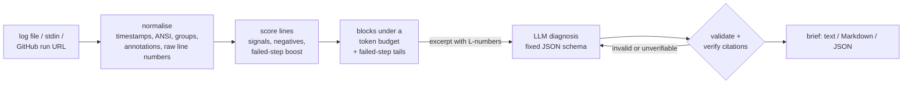

# ci-pinpoint

**Point at the exact lines that broke a CI build, explain why, and prove it.** Every line
it cites is checked against the log, and your coding agent gets a 2,000-token brief instead
of a 200,000-token log.

[](https://github.com/xeeshan16/ci-pinpoint/actions/workflows/ci.yml)


> Status: **day 1 of 7**, working end to end on real logs. Evaluation on a public
> labelled dataset, the MCP server and the GitHub Action land later this week (see
> [docs/PLAN.md](docs/PLAN.md)).

## What it does

A real failed job from this author's own CI: 4,621 lines, 19 failing tests, and the one
line that matters is a `Caused by` buried under Spring stack traces. Nothing near the end
of the log says what went wrong.

```console
$ ci-pinpoint explain https://github.com/xeeshan16/kafka-llm-enricher/actions/runs/40196005593 --no-llm --budget 600
✖ build, static analysis, tests, coverage
  https://github.com/xeeshan16/kafka-llm-enricher/actions/runs/40196005593/job/121176855639
  failed step: Compile (Error Prone), unit and integration tests (Testcontainers), coverage

  excerpt: 589 of ~161,427 tokens (99.6% smaller), 4 block(s)

  L2077   	... 36 more
  L2078   Caused by: java.lang.IllegalArgumentException: unknown PII type 'pan,iban,email,phone'; use pan, iban, email or phone
  L2079   	at io.github.xeeshan16.enricher.privacy.PiiDetectors.named(PiiDetectors.java:70)
  [... 2 more blocks of failing-test assertions ...]
  L4495   [INFO] BUILD FAILURE
      …
  L4500   [ERROR] Failed to execute goal org.apache.maven.plugins:maven-surefire-plugin:3.5.4:test (default-test) on project enricher-spring-boot-starter: There
```

(Real output, abridged in the middle; the run is public. `--no-llm` shows the selection
stage alone, no model involved.)

Without `--no-llm`, a model (local Ollama by default) reads only that excerpt and returns a
diagnosis in a fixed schema: category, summary, root cause, cited lines and a suggested fix.
Citations that don't match the log are dropped before you see them.

<!-- sample-output:start -->
Real model output (Ollama, `qwen2.5:3b` on a CPU-only GitHub runner, 2,000-token budget),
recorded in [real-model run 42667018690](https://github.com/xeeshan16/ci-pinpoint/actions/runs/42667018690)
on a smoke test that failed without printing a single error word:

```text
### ✖ docker image, compose demo smoke test

**The job failed with exit code 1 due to missing configuration.**

`compile` · confidence 1.00 · `ollama/qwen2.5:3b`

**Root cause.** The job encountered an issue with missing configuration for the
'gen_ai_request_model' and 'gen_ai_token_type' metrics. This is indicated by the log entry
'MISSING              gen_ai_request_model' and 'MISSING              gen_ai_token_type'.
The missing configuration prevents the application from starting correctly.

**Evidence** (each line checked against the log):

- `L1757` `MISSING              gen_ai_request_model`
- `L1758` `MISSING              gen_ai_token_type`

**Suggested fix.** Ensure that the 'gen_ai_request_model' and 'gen_ai_token_type' are
properly configured in the application's configuration files.

_Excerpt: 961 of ~63,069 tokens (98.5% smaller), 3 block(s)._
```

The cited lines are right; the category (`compile`) and the last sentence of the root cause
are not: the metrics were missing from the export, the app had started. Category quality is a
day 4 item. On all six labelled logs in that run, a 3B local model produced a verified
diagnosis for 5 and cited the labelled root-cause line in 4 (details in
[docs/PROGRESS.md](docs/PROGRESS.md)). These are six logs, not an evaluation.
<!-- sample-output:end -->

## Quick start (5 minutes)

```bash
# 1. Install (not on PyPI yet; pipx works too)
uv tool install git+https://github.com/xeeshan16/ci-pinpoint

# 2. A local model (or set OPENAI_API_KEY / ANTHROPIC_API_KEY / the Azure variables instead)
ollama pull qwen2.5:3b

# 3. Explain a failed GitHub Actions run. Downloading logs needs a token,
#    even for public repositories.
export GITHUB_TOKEN=$(gh auth token)
ci-pinpoint explain https://github.com/<owner>/<repo>/actions/runs/<run_id>

# ...or any log file, gzip file, or stdin
ci-pinpoint explain build.log
kubectl logs job/integration-tests | ci-pinpoint explain -
```

Useful flags: `--format markdown|json` (Markdown for PR comments and job summaries, JSON for
agents and scripts), `--no-llm` (just the selected lines), `--budget 4000` (excerpt size in
tokens), `--show-excerpt`, `-v`.

Exit codes: `0` diagnosed with at least one verified citation (or `--no-llm`), `1` the model
could not produce a verified diagnosis (the selected lines are still printed), `2` bad input
or configuration.

## Configuration

Flags override environment variables, which override `.ci-pinpoint.toml` in the working
directory (or the file named by `CI_PINPOINT_CONFIG`). See [.env.example](.env.example).

| Variable | Default | Meaning |
|---|---|---|
| `CI_PINPOINT_PROVIDER` | `auto` | `ollama`, `openai`, `anthropic`, `azure`, `openai-compatible`, `fake` (tests only) |
| `CI_PINPOINT_MODEL` | per provider | `qwen2.5:3b` (Ollama), `gpt-4.1-mini`, `claude-haiku-4-5`; Azure uses the deployment |
| `CI_PINPOINT_BASE_URL` | | any OpenAI-compatible server, e.g. vLLM `http://localhost:8000/v1` |
| `OLLAMA_HOST` | `http://localhost:11434` | Ollama server |
| `OPENAI_API_KEY`, `ANTHROPIC_API_KEY` | | hosted providers |
| `AZURE_OPENAI_ENDPOINT`, `AZURE_OPENAI_API_KEY`, `AZURE_OPENAI_DEPLOYMENT`, `AZURE_OPENAI_API_VERSION` | | Azure OpenAI |
| `GITHUB_TOKEN` / `GH_TOKEN` | | download Actions logs; `GITHUB_API_URL` for GitHub Enterprise |
| `CI_PINPOINT_BUDGET_TOKENS` | `2000` | excerpt size sent to the model |
| `CI_PINPOINT_TIMEOUT_S`, `CI_PINPOINT_MAX_RETRIES` | `120`, `3` | per-call timeout, retries with backoff |
| `CI_PINPOINT_LOG_FORMAT` | text | `json` for structured logs on stderr |

With `auto`, the provider is picked from what is set: `ANTHROPIC_API_KEY`, then
`AZURE_OPENAI_ENDPOINT`, then `OPENAI_API_KEY`, then `CI_PINPOINT_BASE_URL`, then local Ollama.

## How it works



1. **Normalise.** Strip timestamps, ANSI codes and progress-bar redraws; split on GitHub
   `##[group]` and GitLab section markers; mark `##[error]` annotations and the script that
   GitHub echoes before each step. Line numbers always refer to the raw log.
2. **Select.** Score each line from weighted signals (exceptions, `Caused by`, compiler
   errors, test failures, OOM kills, refused connections, `MISSING`, "cannot", "invalid")
   with negatives for lines that only look like errors (`Failures: 0, Errors: 0`, `-Werror`)
   and build-tool boilerplate. Lines in the failed step count more; WARN/INFO lines,
   repeated templates and stack frames count less. Windows around the best lines become
   blocks, the tail of every failed step is always a candidate, and blocks are chosen under
   a token budget, skipping blocks that repeat evidence already chosen.
3. **Diagnose.** The model sees only the excerpt, fenced as untrusted data, and must answer
   in a fixed schema. Malformed answers get one repair round trip with the exact error.
4. **Verify.** Each citation must point at a line the model was shown and match its text. A
   wrong line number with a unique verbatim match is corrected and flagged; anything else
   is dropped and counted.

Design decisions are recorded in [docs/adr](docs/adr).

## Development

```bash
uv sync && uv run pytest && uv run ruff check . && uv run mypy
uv run python scripts/fixture_report.py --provider fake   # six labelled real logs
```

The test fixtures are six unmodified failed GitHub Actions job logs from
[xeeshan16/kafka-llm-enricher](https://github.com/xeeshan16/kafka-llm-enricher), each
labelled with the root-cause line(s); a test enforces that selection keeps those lines at
800, 2,000 and 4,000-token budgets. See [CONTRIBUTING.md](CONTRIBUTING.md).

## Limitations (today)

- Selection is heuristic only; embedding ranking and template mining arrive on day 2, and
  there is no evaluation on a public dataset yet (day 3). Six hand-labelled logs are a
  smoke test, not a benchmark.
- Token counts are estimates (3.5 characters per token), not tokenizer-exact.
- GitHub Actions URLs only; GitLab logs work as files or stdin.
- Secrets are not yet redacted before the prompt (day 4). GitHub masks registered secrets
  in logs, but do not send logs with unmasked secrets to a hosted model.

## License

MIT. Fixture logs come from the MIT-licensed kafka-llm-enricher CI.
